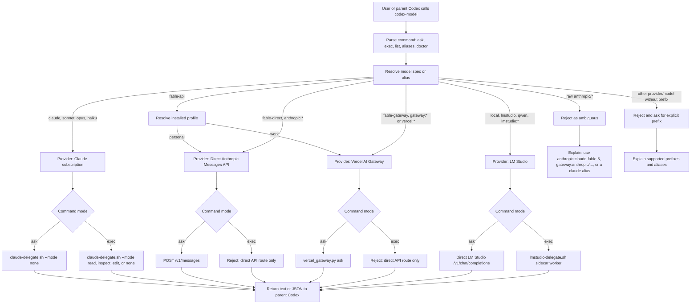

# Codex Model Router: How It Works

Version: 1.3.5
Last updated: 2026-09-07

`codex-model` is a local router, not a replacement for the normal Codex model. It gives Codex a consistent command surface for asking or delegating to other model backends while keeping provider-specific auth, billing, tool support, and failure modes explicit.

The wrapper has three jobs:

- Resolve a human-friendly model name into a provider and concrete model id.
- Send the work through the safest available adapter for that provider.
- Keep ambiguous or expensive routes explicit, especially Vercel Gateway API routes versus Claude Code subscription routes.
- Append deterministic usage events when a run supplies `--usage-events` or `AI_USAGE_EVENTS_PATH`.

## Router Flow



## Provider Decisions

### Claude

Claude routes through Claude Code because the intended spend path is the logged-in Claude subscription, not the Perplexity API. The router calls the existing `claude-code-delegate` helper so Claude keeps its own auth and permission model.

Use the Claude Code route only when the user explicitly asks to delegate to Claude, Claude Code, Opus, Sonnet, Fable, or `claude-code-delegate`, subject to that skill's supported models and route constraints. Continue work already authorized for that path without asking again. A useful second opinion is a reason to propose Claude, not to invoke it. Writing a prompt for Claude does not authorize running it.

### Direct Anthropic Messages

Direct Anthropic Messages is the explicit API route for Claude Fable when the user wants the Anthropic provider, not Vercel Gateway or Claude Code subscription. The router sends `POST /v1/messages` with `x-api-key`, `anthropic-version`, `model`, `max_tokens`, and `messages`. For `claude-fable-5`, the default direct route uses `thinking.type = "adaptive"` and `output_config.effort = "high"` unless the caller overrides or omits effort.

Use this route for direct text-only Fable passes. It is not a fully-tooled Codex provider and does not provide a sidecar `exec` mode. `fable-api` selects it on the personal profile; `fable-direct` and `anthropic:claude-fable-5` select it explicitly on either profile.

### Vercel AI Gateway

Vercel AI Gateway is the explicit direct API route for non-native model passes. The router calls `vercel-ai-gateway/scripts/vercel_gateway.py`, which uses the Gateway OpenAI-compatible Chat Completions API and appends deterministic usage events when requested.

Use Gateway when the user explicitly asks for Vercel Gateway, OpenAI-compatible Gateway calls, or a non-native model that is not available through a subscription CLI. Use explicit `gateway:provider/model` IDs for concrete model selection. For Vercel-routed Claude Fable, use `gateway:anthropic/claude-fable-5` or `fable-gateway`; the work profile also resolves `fable-api` here. For direct Anthropic Fable, use `fable-direct` or `anthropic:claude-fable-5`; the personal profile also resolves `fable-api` there. For Claude subscription work, use the Claude aliases instead.

### LM Studio

LM Studio routes to the local OpenAI-compatible server for simple `ask` calls and to the existing LM Studio delegate helper for `exec`. The router checks `/v1/models` before local chat calls so a missing local model fails before a long request starts.

Use LM Studio when the user asks for local, offline, LM Studio, or the default local model.

## Commands And Modes

`ask` is for single prompt responses. It avoids extra tool permissions where possible:

- Claude: `claude-delegate.sh --mode none`
- Direct Anthropic: `POST /v1/messages`
- Vercel AI Gateway: direct OpenAI-compatible Chat Completions call
- LM Studio: direct local chat completion

`exec` is for sidecar workers that can inspect or edit within a bounded permission mode:

- `--mode none`: no tool access
- `--mode read`: read-only repository inspection
- `--mode inspect`: broader inspection when supported by the helper
- `--mode edit`: workspace edits, only when explicitly requested

The parent Codex session still owns integration, review, and verification after any sidecar result.

## Usage Event Handling

`codex-model` does not estimate spend. It records tool-reported usage where available and records `telemetry_status=unavailable` where a sidecar route does not expose usage metadata.

| Route | Usage behavior |
|---|---|
| Claude `ask` | Parses Claude delegate JSON for tokens and cost when available. |
| Claude `exec` | Parses JSON output when available; otherwise appends an unavailable telemetry event. |
| Direct Anthropic `ask` | Records token usage from the Anthropic Messages response when returned. |
| Direct Anthropic `exec` | Not supported because direct Anthropic is a text-only API route, not a Codex sidecar worker. |
| Gateway `ask` | Passes usage capture to `vercel_gateway.py`, which records Chat Completions usage and Gateway spend when returned. |
| Gateway `exec` | Not supported because Gateway is a direct API route, not a Codex sidecar worker. |
| LM Studio `ask` | Records OpenAI-compatible `usage` when returned. |
| LM Studio `exec` | Appends an unavailable telemetry event unless the helper later exposes usage. |

## Guardrails

- Raw `anthropic/*`, `google/*`, and `openai/*` model ids are rejected because they are ambiguous between Gateway API, direct provider APIs, native Codex, and subscription routes.
- `fable-api` is profile-aware; use `fable-direct` or `fable-gateway` when provider billing must be explicit.
- Use `anthropic:claude-fable-5` for direct Anthropic Messages and `gateway:anthropic/...` for Vercel Gateway.
- Ambiguous slash-style model ids require `gateway:` or `lmstudio:` prefixes.
- Perplexity API aliases and prefixes are retired in this router; use Gateway API routes or Claude Code subscription routes instead.
- Normal fully-tooled Codex remains the default when the task needs apps, MCP tools, plugins, browser control, or integrated code editing.
- `doctor --json` checks helper paths, Claude auth, Gateway auth/model discovery, and LM Studio reachability.
- `doctor --strict --json` fails if every optional route family is not available. Without `--strict`, optional missing routes are reported without failing core installed route health.

## Install Notes

The shared example skills package includes the router script, but Codex still needs a shell entrypoint on `PATH`.

After installing the skill through `example-skills`, run:

```bash
~/.codex/skills/codex-model-router/scripts/install-wrapper.sh
codex-model doctor --json
```

The wrapper creates or refreshes `~/.local/bin/codex-model` as a symlink to the skill's `scripts/codex-model.py`.
